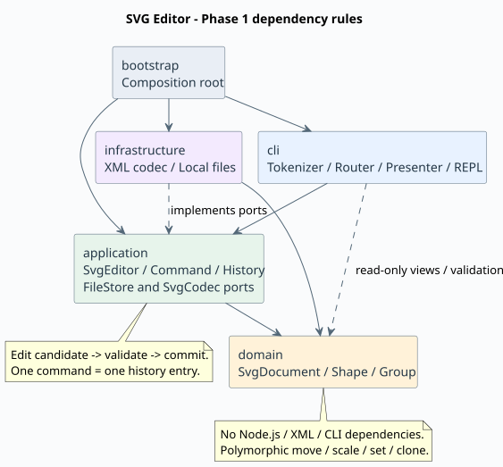

# SVG 编辑器：架构方案、过程记录与质量保证

对应 `phase_cli_1.md` 的 Lab1 Phase 1。工程采用 TypeScript 严格模式与面向对象设计，实现六种内置图形和全部 19 条课程命令。box 和插件加载器属于后续阶段。

## 1. 架构方案

### 1.1 模块划分与职责

| 模块                             | 主要对象                                                         | 职责                                                      |
| -------------------------------- | ---------------------------------------------------------------- | --------------------------------------------------------- |
| `src/domain/`                    | SvgDocument、Shape、GeometryShape、六类图形                      | 封装几何、属性校验、id 与有序树结构，提供多态编辑和深拷贝 |
| `src/application/`               | SvgEditor、CommandHistory、ShapeFactory                          | 文档用例、编辑事务、历史屏障与统一创建入口                |
| `src/application/commands/`      | EditCommand、十个具体编辑命令                                    | 一条编辑请求对应一个对象，封装执行与撤销/重做状态         |
| `src/application/ports/`         | FileStore、SvgCodec 接口                                         | 定义文件与格式边界，不规定具体实现                        |
| `src/cli/`                       | Tokenizer、CommandArguments、CommandRouter、ShapePresenter、Repl | 语法、文本显示和逐行交互，不实现几何算法                  |
| `src/infrastructure/`            | LocalFileStore、XmlSvgCodec                                      | 实现端口：真实文件 IO 与 XML/SVG 转换                     |
| `src/bootstrap/`                 | main.ts                                                          | 创建对象、注入依赖，选择交互、脚本或管道模式              |
| `test/`、`examples/`、`scripts/` | 测试、示例、架构检查                                             | 可重复验收和维护工具                                      |

字段由类封装。`geometry()`、`attributes()` 返回新的只读对象；`children()` 返回数组副本。几何、样式和父子关系通过对象行为修改。id 区分大小写，合成画布根不占用用户 id。

第一阶段使用 O(n) 树遍历查找 id，避免额外索引与树同步的一致性风险；若出现规模瓶颈，可在 SvgDocument 内部增加索引。

### 1.2 PlantUML 组件图



可编辑源文件：[architecture.puml](architecture.puml)。箭头表示允许的依赖方向。图使用 PlantUML 1.2025.10 的 Smetana 布局生成，运行编辑器不需要 Java 或 Graphviz。

### 1.3 设计模式与实际落地

**Command：封装请求。** CreateCommand、DeleteCommand、MoveCommand、ScaleCommand、SetCommand、GroupCommand、UngroupCommand、AddToCommand、FrontCommand、BackCommand 继承 EditCommand。命令接收解析好的参数，不读取终端、不写文件。CommandHistory 只在成功后入栈；undo 后的新编辑清空 redo；显示命令绕开历史。

**Memento 思路：快照恢复。** EditCommand 先克隆文档，在工作副本上执行具体操作，全部成功后保存前后状态，SvgEditor 再替换当前文档。后续编辑继续克隆，不修改历史中的文档。undo/redo 恢复对应快照，不重新执行命令或分配 id。

相较于为每个结构编辑手写逆操作，快照更容易完整恢复父链接、子树和兄弟顺序。代价是每次编辑 O(n) 复制，h 条历史占 O(hn) 空间。最终审查撤销了原先自行加入的 100 步截断，保持课程要求的完整历史语义；大型文档阶段再考虑增量差异、不可变树共享或明确可配置的资源策略。

**Composite：统一容器与叶子。** Shape 定义 move、scale、setAttribute、clone 等协议；叶子类维护自身几何，Group 将移动和缩放递归委托给孩子。删除 Group 会删除整棵子树。命令层没有按图形标签分派几何操作。

**Factory：集中创建。** ShapeFactory 是唯一的“类型名 → 构造策略”入口，CLI 创建和 SVG 导入共享它。参数 schema 与构造策略集中登记，属性修改仍由对象自身校验。

按课程要求保留并标记两处待重构的名称分派：

1. CommandRouter：命令名 → 用例，未来可提取命令提供者注册接口。
2. ShapeFactory：类型名 → 内置构造策略，未来替换为 ShapeProvider 注册机制。

没有散布 switch(tag)，不宣称本阶段已经实现插件系统。

### 1.4 依赖方向规则

| 来源           | 可依赖模块                          | 原因                                       |
| -------------- | ----------------------------------- | ------------------------------------------ |
| domain         | domain                              | 几何与结构不依赖运行环境                   |
| application    | application、domain                 | 用例调用领域，通过本层端口抽象 IO          |
| cli            | cli、application、domain            | 调用应用用例，使用领域值校验及只读投影展示 |
| infrastructure | infrastructure、application、domain | 实现应用端口并转换领域对象                 |
| bootstrap      | 全部运行模块                        | 唯一依赖装配入口                           |

domain 和 application 禁止外部包与 Node.js API；application 禁止反向依赖 CLI 或具体基础设施。CLI 不直接修改模型，所有编辑经由命令执行。

`scripts/check-architecture.mjs` 检查全部源码的静态导入、一类一文件、类名与文件名匹配，以及 tag/type switch。它不能代替语义审查；“CLI 不直接修改模型”还需人工检查调用方式。

### 1.5 变化点假设

| 变化点               | 已留出的空间与取舍                                                                         |
| -------------------- | ------------------------------------------------------------------------------------------ |
| 新图形、box、插件    | 多态 Shape 和集中工厂；后续仍需设计 provider、注册 schema 和类型恢复，当前不承诺零内核修改 |
| 新命令、GUI 或 agent | 编辑用例是独立命令类，可复用应用入口；尚未实现图形界面                                     |
| 文件系统或存储方式   | 替换 FileStore 实现，应用层不变                                                            |
| SVG 库或导入范围     | 修改 XmlSvgCodec，不把 XML DOM 混入领域                                                    |
| 大文档和长历史       | 可增加 id 索引、替换快照存储；当前接受线性查找和完整快照历史                               |
| transform 与复杂样式 | 已支持平移、正等比缩放归一化；旋转、不等比矩阵和 CSS 仍留待后续                            |

## 2. 行为约定与阶段边界

以下补足需求未完全定义的行为，便于重复验收；若教师给出不同解释，以课程要求为准。

### 2.1 几何、分组与顺序

- scale 将位置与尺寸一起乘以正系数，不修改 stroke-width、文字内容和字号，不写入 transform。
- group 至少一个目标，重复目标或祖先与子孙同时选中时整条失败。
- group 中的孩子按操作前文档的深度优先绘制顺序排列，不使用命令参数顺序。新组放在目标的最低共同祖先中，占据首个目标所在直接分支的位置；原容器变空时保留。
- 跨层重组后的继承样式可能随新父级改变，本阶段不计算和固化 CSS 样式；undo 精确恢复原层级与属性。
- ungroup 按要求拒绝顶层容器；嵌套容器解散后，孩子按顺序占据其位置。常见继承样式补给未显式覆盖的孩子，不复制 id/data-kind 等元数据。
- front 移到兄弟列表末尾，back 移到开头，符合 SVG 后绘制者覆盖前者的顺序。addto 追加为最后一个孩子；禁止形成环。
- 对 g 设置 fill/stroke 使用 SVG 继承，显式覆盖样式的孩子保留自身属性。

### 2.2 历史与原子性

- 每条成功编辑是一个历史单元，包括零增量移动。显示命令与失败命令不入栈。
- 成功的 init/read/save/canvas 修改清空历史并设置屏障，undo/redo 报 `error: undo not allowed after io command`。
- 下一次成功编辑解除屏障并建立新历史；失败编辑不解除屏障。canvas 查询不形成屏障。
- 编辑先在副本中完成；即使递归缩放在后半段溢出，当前文档仍保持完整原状。
- 提交前校验整棵树的唯一 id、父链接、无环与 128 层上限；CLI 和导入器使用相同深度边界，避免成功创建的图形保存后无法读回。
- read 在完整 XML、id、属性和子树检查成功后才替换文档，之后才发布补 id 警告。
- save 在目标目录写唯一临时文件，再重命名替换目标；失败时清理临时文件，保持当前文档、历史和路径。无参数 save 始终优先使用最近 read 的路径，显式另存到其他文件不改变该默认值。对于 init 新建的文档，首次成功保存可建立默认路径；init 清除路径。
- 文件替换不包含断电持久化保证，也不处理多个进程同时保存同一文件的业务冲突。

### 2.3 SVG 导入范围

支持六种内置元素、浮点坐标、px 画布尺寸、默认几何值 0、文本/CDATA、fill/stroke/stroke-width，以及 font-size、text-anchor、data-kind 等附加属性的保存读回。未指定画布尺寸时默认 800×600。

先收集所有显式 id，再按“标签+序号”补 id，避开文件后部才出现的名称。重复 id、非法维度与无效 XML 拒绝导入。根 svg 不在图形 id 寻址范围内。

支持元素上的 translate(x[,y])、scale(s) 和相等双参数 scale(s,s)，可串联并嵌套。变换列表按 SVG 顺序后乘，嵌套使用 parent∘local；例如 translate(10,20) scale(2) 将 (3,4) 变为 (16,28)。导入把每个叶子的累计变换应用到几何，保留 g 层级，导出不再保留 transform。之后 show/set/move 使用画布坐标；CLI scale 仍遵守课程只缩放几何的规则。

SvgImportContext 同时记录原始继承长度与累计变换，避免对子孙重复缩放。字号和 stroke-width 在有自身值或局部缩放变化时固化，未覆盖的孩子继续继承；逆缩放相消时也正确重置父级已放大的值。线宽初值为 1；无显式字号时，本项目按常见桌面环境约定为 16px，这不是 SVG 规范对 medium 的固定定义。变换规则依据 [SVG 1.1 坐标变换](https://www.w3.org/TR/SVG11/coords.html#TransformAttribute) 和 [样式继承](https://www.w3.org/TR/SVG11/styling.html#Inheritance)。

当前不支持旋转、不等比或非正缩放、一般 matrix、CSS、path、tspan、非 SVG 命名空间、非 xml 的命名空间附加属性、百分比画布尺寸、根级附加样式和不同坐标系的 viewBox。viewBox 若存在，必须为 `0 0 width height`。缩放下未实现的虚线、字间距、文字偏移、圆角等长度敏感附加属性，以及相对字号单位，会明确拒绝，避免静默失真。DTD、实体声明、样式表处理指令和事件属性也拒绝。

普通附加属性能往返保存，但不保证任意 SVG 高级属性在重组或几何修改后的视觉语义；复杂透明度和引用不属于本阶段编辑保证。需求开头的嵌套 translate/scale 示例已经纳入回归与离线渲染验收。

SvgString 在模型入口检查 XML 1.0 合法字符，包括孤立代理项；非法字符串不会进入历史或保存文件。编码时把文本回车保存为字符引用，防止再次读入时被 XML 换行规范改为 LF。

data-kind="box" 按普通 g 读回并保留标记；create box 仍报 unknown shape type，符合未安装插件时的降级方向。

### 2.4 交互

- `#` 仅在线首（忽略前导空白）表示整行注释，不吞掉颜色值。
- 双引号支持空字符串、空格、转义引号和反斜杠；其他反斜杠字面保留，便于 Windows 路径。加引号的文字 `"in"` 不会误识别为 create 尾缀。
- 终端模式显示欢迎语与 svg>；管道和脚本模式不显示提示符。
- 脚本出错后继续执行剩余行，最终退出码 1；全部成功为 0。交互错误不会退出程序。
- 规定错误字符串保持一致；成功和撤销反馈使用摘要，不逐字复刻示例的自然语言输出。

## 3. 过程记录

以下记录本次实际发生的协作过程，不把 AI 自动生成结果写成学生已经逐条审阅。提交者应亲自运行、理解代码，再补充自己的判断。

| 阶段     | 问题或决策                                                | 确认与处理                                                             |
| -------- | --------------------------------------------------------- | ---------------------------------------------------------------------- |
| 需求梳理 | 只有需求文件，没有代码和 Git；box 不属本阶段              | 保留原文，先提交架构初稿和工程骨架，分阶段开发                         |
| 环境     | npm 系统缓存不可写，出现 EPERM                            | 项目 .npmrc 使用本地缓存，不修改全局权限                               |
| 模型设计 | 初步方案提及索引，实际没有性能证据支持双份结构            | 改为树遍历，在变化点中记录复杂度与未来优化                             |
| 事务设计 | 手写分组/删除逆操作容易遗漏父链接与顺序                   | 用副本执行和前后快照；逐条验证完整撤销恢复                             |
| 首次构建 | TypeScript 7 的 Node 类型未加载；XML localName 类型可为空 | 显式 types:["node"]，增加 tagName 后备；严格构建通过                   |
| 导入校验 | 只检查已读前缀会让补 id 与后续显式 id 冲突                | 先全量收集；专门构造前方缺 id、后方已有 rect1/g1 的测试                |
| 依赖修订 | CLI 展示和值校验使用了领域接口，初稿规则过窄              | 允许受限 CLI→domain；禁止直接修改领域对象，更新图与检查脚本            |
| 输出审查 | 空容器移动多余冒号；解组复制所有属性会传播元数据          | 摘要按详情拼接；只传播常见继承属性，经正常样式入口写入                 |
| 验收增强 | 单条操作测试不足以说明长历史可靠                          | 增加课程会话、真实进程、文件系统及四组固定种子连续编辑                 |
| 远程交付 | 用户授权新建仓库，已有正常 GitHub 凭据                    | 创建私有仓库并分步推送；凭据不写入项目文件                             |
| CI 授权  | 当前 OAuth 凭据缺少 workflow 权限，GitHub 拒绝推送工作流  | 将尚未发布的配置改为 ci/github-actions.yml 模板，不扩大凭据权限        |
| 视觉检查 | 浏览器本地预览请求被权限策略拒绝                          | 停止该检查并关闭临时服务器；不宣称完成目视验收，保留结构与往返验证证据 |

最终复查补充：发现导入器有 128 层上限，但 CLI 原先可以创建更深的结构；已增加提交前全树校验，并验证 create/group/addto 超限均原子失败。另拒绝无法可靠往返保存的未知命名空间属性，避免输出丢失命名空间声明的 SVG。

### 2026-10-21 交付收尾

- 独立审查确认：100 步截断不是课程要求，现已移除；106 条连续编辑能够完整撤销并重做。
- 用标准 XML 解析器确认非法控制字符会让输出无法打开，现由 SvgString 统一拒绝；同时修复 CR 文本往返和外部样式表被忽略的问题。
- 发现显式 fill=inherit 在解组后会改为继承新父级，已在解组前沿原继承链计算并固化，增加对应回归。
- 根据 SVG 规范实现常见变换归一化；独立复查额外比较了 48 组支持范围内的嵌套组合，未发现必须修正的语义错误。部分栅格边缘存在极小的浮点/抗锯齿差异，未宣称任意场景逐像素一致。
- 课程变换示例的原图与导入后保存图由同一离线渲染器比较，像素差为 0。已实际查看流程图、历史示例和变换示例 PNG，确认中文、颜色、布局和连线可见。浏览器原生目视检查仍未执行，没有绕过之前被拒绝的浏览器访问。
- 完整文件与子进程测试在受限临时目录环境出现权限错误；在正常本机文件权限环境复验通过。离线验证脚本曾逐次读取原生 pixels getter，造成重复复制，已改为一次缓存两个像素缓冲区。
- 原 final 指向的交付版本将另存归档标签，再将 final 更新到本次最终提交，保留既有开发与交付记录。

再次逐条对照实验原文时，发现 save 显式导出后曾把默认路径改到新文件，与“无参数时保存到读入时路径”的要求不完全一致。本轮已修正为保留最近 read 的路径，并验证读入另一文件后默认目标随 read 更新。不是仅凭原有 82 项测试通过就认定每个边界都已符合要求。

## 4. 一致性自查

### 4.1 模块划分是否一致

实际目录与最终方案一致。运行时导出的类一类一文件、文件名匹配类名；main.ts 只负责装配。相对初稿的修订已记录：使用树遍历、受限 CLI 领域依赖、快照历史与明确 SVG 子集。

### 4.2 依赖方向是否被违反

自动检查覆盖全部源码的静态导入，当前无违反最终规则的依赖。抽样确认：

- Rect 只依赖领域中的 GeometryShape，不认识 XML 与命令行。
- SvgEditor 依赖 FileStore/SvgCodec 端口类型，没有导入具体适配器。
- MoveCommand 调用 shape.move()，没有按图形标签分支。
- CommandRouter 构造命令，通过 editor.edit() 修改文档。
- XmlSvgCodec 实现 SvgCodec 并转换领域对象，DOM 类型没有进入领域。
- main.ts 统一装配工厂、端口实现、应用与 CLI。

新增代码仍须检查；正则形式的依赖检查不能证明所有运行时行为均符合架构。

## 5. 质量保证手段

### 5.1 可重复检查

```sh
npm ci
npm run check
npm run test:coverage
npm run cli -- --script examples/flowchart.commands
npm run cli -- --script examples/history.commands
npm run cli -- --script examples/transforms.commands
npm run verify:visual
```

check 顺序执行格式、严格编译、自动测试、架构检查。`ci/github-actions.yml` 提供 Ubuntu/Windows × Node 22/24 的 CI 模板。当前 OAuth 授权缺少 workflow 权限，模板尚未启用，远程跨平台结果未验证；启用方式见 [CI 说明](../ci/README.md)。

### 5.2 测试与验收依据

| 测试               | 主要证据                                                                              |
| ------------------ | ------------------------------------------------------------------------------------- |
| domain.test.ts     | 多态移动缩放、深拷贝、尺寸和有限数、循环包含、id 与父链接                             |
| commands.test.ts   | 全部编辑的精确撤销重做、分组顺序、跨层归属、屏障、失败不变、超过 100 步仍完整保留历史 |
| svg.test.ts        | 六类 SVG 往返、中文/XML 转义、补 id 避碰、不支持输入的原子拒绝、深度限制              |
| cli.test.ts        | 引号与 Windows 路径、参数错误、REPL、真实文件替换、真实进程和退出码                   |
| acceptance.test.ts | 课程完整会话与八元素流程图；四个种子各 60 次连续编辑，逐状态完整撤销重做              |
| strings.test.ts    | 非法 XML 字符、孤立代理项、合法 Unicode、CR 与属性空白往返                            |
| transforms.test.ts | 组合顺序、六类几何、字号描边继承、逆缩放、非法变换与原子拒绝                          |

测试在失败后继续撤销上一条成功命令，验证历史未被隐藏损坏。真实文件测试使用独立临时目录并清理，不修改用户已有 SVG。

本地验收 83 项测试全部通过。覆盖率测量约为运行时行覆盖率 99.7%、分支 97%；它只是辅助证据，不能证明没有缺陷。运行时依赖审计未发现已知漏洞。离线图像检查已完成，浏览器原生目视检查仍未执行。

`npm run verify:visual` 使用开发依赖 resvg-js 在本地渲染，不启动浏览器或服务器。输出位于 artifacts/visual，包括三组预览和带源文件 SHA-256 的比较报告；提交中保留一份结果于 [visual-verification](visual-verification/)。课程变换示例的 400×200 图像比较结果为 differingChannels=0、meanAbsoluteChannelDifference=0。字体会影响跨平台渲染，但每次比较在同一环境、同一字体下进行。

功能对应：文档类由 IO/屏障测试验证；六类 create/in 由模型与流程图验证；move/scale/set 由多态与非法数值验证；delete/group/ungroup/addto/front/back 由树顺序和完整快照验证；tree/show/help 由输出与会话验证；undo/redo 由单命令、长序列及分支历史验证。架构、过程与提交历史共同提供工程质量证据。

## 6. 交付

仓库：<https://github.com/zero0307/svg-editor-cli>（私有）。开发历史在 main，最终交付以 final 标签标记并推送。提供的需求没有具体截止时间，提交者需自行核对课程平台。

私有仓库尚未向教师/助教分享，也没有代为提交课程平台。请按课程要求提供访问权限，并亲自运行示例、在浏览器打开导出的 SVG，理解 Command 快照、Composite 递归、依赖规则和阶段限制后再提交。
